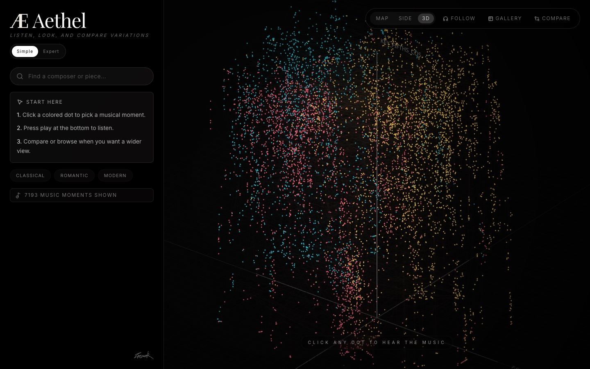

<h1 align="center">
  <a href="https://aethel.songhai.site">
    <picture>
      <source media="(prefers-color-scheme: dark)" srcset=".github/brand/lockup-dark.svg" />
      
    </picture>
  </a>
</h1>

<p align="center"><b>Listen, look and compare variations.</b></p>

<p align="center">
  <a href="https://aethel.songhai.site">Live explorer</a> ·
  <a href="#run-the-explorer">Run the explorer</a> ·
  <a href="docs/project_engineering_explanation.md">Engineering notes (中文)</a> ·
  <a href="PROJECT_PROGRESS.md">Progress log</a> ·
  <a href="README.zh-CN.md">中文</a>
</p>



Aethel turns the theme and each variation of a Theme & Variations piece into a visual object you can hear, see and compare. It asks whether variations that sound alike also look alike, and whether similarity in a deep audio embedding can be explained with interpretable features.

## How it works

Heavy audio work runs offline in Python; the browser only reads the results.

```text
CSV annotation → raw WAV → segmented WAV → handcrafted features + MERT embeddings
  → similarity, reduction and clustering → waveform thumbnails → React + Three.js explorer
```

- **Annotations:** `data/TV_annotation_clean.csv` holds 692 recordings (Classical, Romantic and Modern) with the boundaries and labels of each theme (`T`), variation (`V1`…`Vn`) and extra section.
- **Features:** 35 handcrafted audio features per segment, and MERT-v1-330M embeddings.
- **Explorer:** Map, Side and 3D views, Follow, Gallery and Compare. Click a dot to hear that moment.

## Repository layout

| Path | What it is |
| --- | --- |
| [tv_core.py](tv_core.py) | Core library: dataset, handcrafted features, MERT embedder, similarity |
| [backend/pipeline](backend/pipeline) | Ordered processing scripts: cut segments, extract features and embeddings |
| [backend/analysis](backend/analysis) | Feature selection, reduction, clustering and thumbnail rendering |
| [backend/export](backend/export) | Writes the explorer's data files to `explorer_app/src/data/` |
| [notebooks](notebooks) | The main pipeline notebook; run it from the repository root |
| [explorer_app](explorer_app) | The React, Vite and Three.js explorer deployed to the live site |
| [docs](docs) | Engineering notes and cluster analysis (Chinese) |

## Run the explorer

You need Node.js and npm.

```sh
cd explorer_app
npm install
npm run dev
```

Open `http://localhost:3000`. The explorer reads pre-computed files in `explorer_app/src/data/`, so it runs without Python or audio.

Audio files are not in this repository. Regenerating features or embeddings needs the audio and the Python environment described in [AGENTS.md](AGENTS.md).

<br />

<!-- series-footer:start -->

<p align="center">
<a href="https://syuze.songhai.site"></a>&nbsp;
  <a href="https://news-metro.songhai.site"></a>&nbsp;
  <a href="https://narrative-graph.songhai.site"></a>&nbsp;
  <a href="https://visdelta.songhai.site"></a>&nbsp;
  <a href="https://cytocausal.songhai.site"></a>&nbsp;
  <a href="https://aethel.songhai.site"></a>
</p>

<p align="center"><a href="https://github.com/SonghaiFan/perspectiva">Perspectiva</a> · <a href="https://github.com/SonghaiFan/access">Access</a></p>

<p align="center"><sub>Frank series · Made by <a href="https://github.com/SonghaiFan">Songhai Fan</a></sub></p>

<!-- series-footer:end -->

<p align="right">
  <picture>
    <source media="(prefers-color-scheme: dark)" srcset=".github/brand/frank-signature-dark.svg" />
    
  </picture>
</p>
