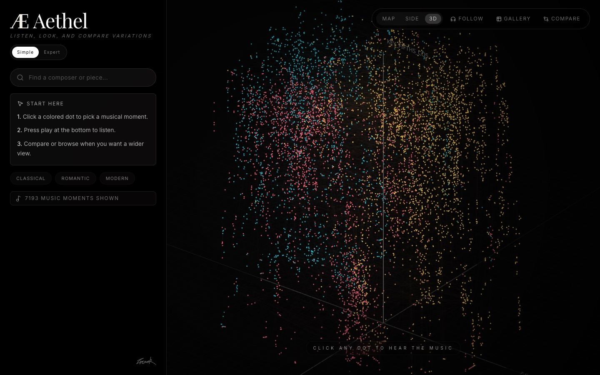

<h1 align="center">
  <a href="https://aethel.songhai.site">
    <picture>
      <source media="(prefers-color-scheme: dark)" srcset=".github/brand/lockup-dark.svg" />
      
    </picture>
  </a>
</h1>

<p align="center"><b>听、看、比较变奏。</b></p>

<p align="center">
  <a href="https://aethel.songhai.site">在线浏览</a> ·
  <a href="#运行浏览器前端">运行前端</a> ·
  <a href="docs/project_engineering_explanation.md">工程说明</a> ·
  <a href="PROJECT_PROGRESS.md">进度记录</a> ·
  <a href="README.md">English</a>
</p>



Aethel 把主题与变奏（Theme & Variations）作品中的主题和每段变奏，变成可以听、可以看、可以比较的视觉对象。它想回答：听起来相似的变奏，看起来是否也相似？深度音频表示中的相似性，能否用可解释的特征来说明？

## 工作原理

繁重的音频计算在 Python 中离线完成；浏览器只读取结果。

```text
CSV 标注 → 原始 WAV → 切分后的 WAV → 手工特征 + MERT embedding
  → 相似度、降维与聚类 → 波形缩略图 → React + Three.js 浏览器
```

- **标注：** `data/TV_annotation_clean.csv` 收录 692 条录音（古典、浪漫和现代时期），记录每段主题（`T`）、变奏（`V1`…`Vn`）和附加段落的边界与标签。
- **特征：** 每个片段 35 维手工音频特征，以及 MERT-v1-330M embedding。
- **浏览器：** Map、Side 和 3D 视图，以及 Follow、Gallery 和 Compare。点击一个点就能听到对应的片段。

## 目录结构

| 路径 | 内容 |
| --- | --- |
| [tv_core.py](tv_core.py) | 核心库：数据集、手工特征、MERT 提取、相似度 |
| [backend/pipeline](backend/pipeline) | 按顺序执行的处理脚本：切分片段、提取特征和 embedding |
| [backend/analysis](backend/analysis) | 特征选择、降维、聚类和缩略图渲染 |
| [backend/export](backend/export) | 把浏览器所需的数据写入 `explorer_app/src/data/` |
| [notebooks](notebooks) | 主流程 notebook；需要从仓库根目录运行 |
| [explorer_app](explorer_app) | 部署到线上站点的 React、Vite 与 Three.js 浏览器 |
| [docs](docs) | 工程说明和聚类分析（中文） |

## 运行浏览器前端

需要 Node.js 和 npm。

```sh
cd explorer_app
npm install
npm run dev
```

打开 `http://localhost:3000`。浏览器读取 `explorer_app/src/data/` 中预先计算好的文件，所以不需要 Python 或音频也能运行。

音频文件不在这个仓库里。重新生成特征或 embedding 需要音频和 [AGENTS.md](AGENTS.md) 中说明的 Python 环境。

<br />

<!-- series-footer:start -->

<p align="center">
<a href="https://syuze.songhai.site"></a>&nbsp;
  <a href="https://news-metro.songhai.site"></a>&nbsp;
  <a href="https://narrative-graph.songhai.site"></a>&nbsp;
  <a href="https://visdelta.songhai.site"></a>&nbsp;
  <a href="https://cytocausal.songhai.site"></a>&nbsp;
  <a href="https://aethel.songhai.site"></a>
</p>

<p align="center"><a href="https://github.com/SonghaiFan/perspectiva">Perspectiva</a> · <a href="https://github.com/SonghaiFan/access">Access</a></p>

<p align="center"><sub>Frank series · Made by <a href="https://github.com/SonghaiFan">Songhai Fan</a></sub></p>

<!-- series-footer:end -->

<p align="right">
  <picture>
    <source media="(prefers-color-scheme: dark)" srcset=".github/brand/frank-signature-dark.svg" />
    
  </picture>
</p>
