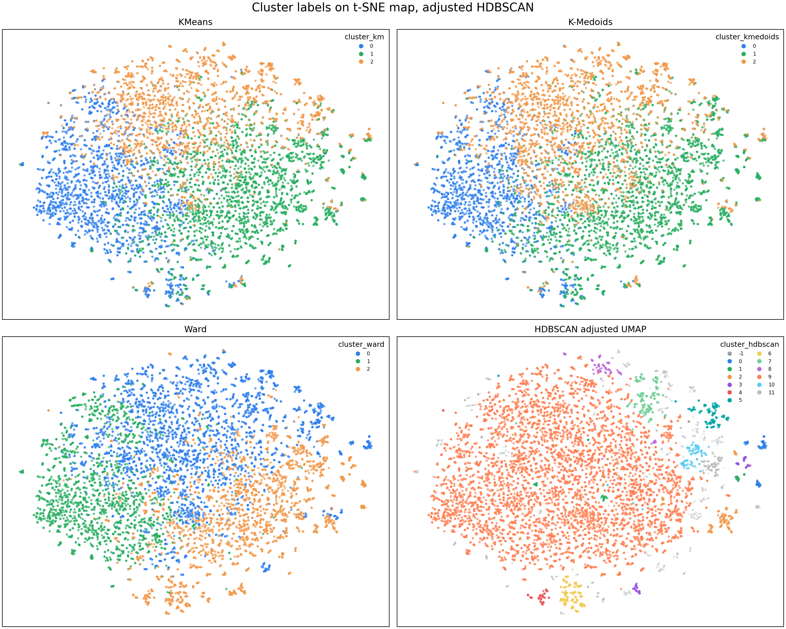
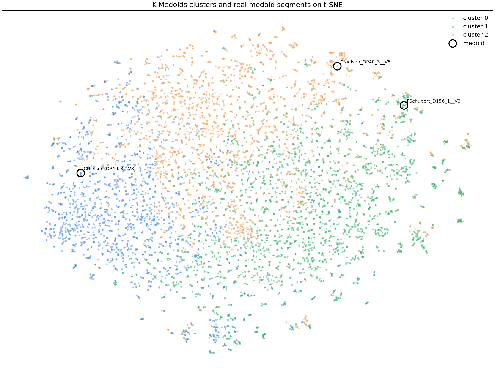
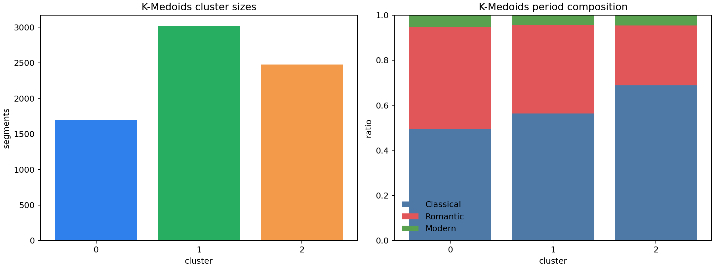
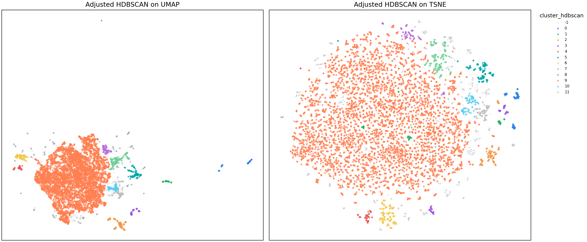
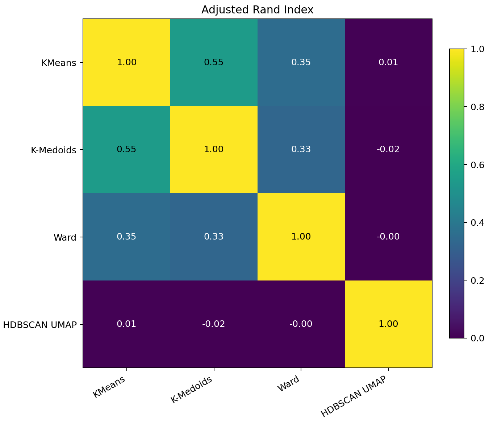

# Cluster Analysis Notes

Generated from the full core-segment MERT embedding set on 2026-05-16.

Data scope:

- 7,193 core segments
- MERT-v1-330M embeddings, `all_layers_mean` pooling
- Primary map coordinates from the existing t-SNE / UMAP reduction outputs
- Cluster table: `embeddings/clusters_embedding.csv`
- Frontend-ready files: `explorer_app/src/data/segment_visualization.csv`, `cluster_summary.json`, `cluster_summary.csv`

## Methods

We keep four clustering views because each one answers a different question.

| Method | Output column | Role | Recommended frontend use |
| --- | --- | --- | --- |
| KMeans | `cluster_km` | Global partition baseline | Alternate color mode |
| K-Medoids | `cluster_kmedoids` | Global partition with real representative segments | Primary cluster color candidate |
| Ward | `cluster_ward` | Hierarchical partition at the same K | Structural comparison / future tree view |
| HDBSCAN | `cluster_hdbscan`, `is_outlier` | Density islands and outliers on UMAP | Outlier highlight / density-island overlay |

KMeans, K-Medoids, and Ward use the embedding PCA clustering space. HDBSCAN is intentionally different: it uses UMAP 2D as its density space, because the PCA10 density result collapsed into one very large cluster.

## Visual Overview



KMeans and K-Medoids both produce broad, spatially coherent regions on t-SNE. Ward also forms coherent regions, but cuts the space differently. HDBSCAN should not be interpreted as a competing global partition; it identifies density islands and outliers.

## Primary Cluster Candidate: K-Medoids



K-Medoids is the strongest default candidate for the explorer because every cluster center is a real segment that can be played and displayed as a thumbnail.

| Cluster | Size | Representative | Theme Ratio | Period Sketch |
| --- | ---: | --- | ---: | --- |
| 0 | 1,697 | `CNielsen_OP40_3__V8` | 0.1880 | Classical 841; Romantic 766; Modern 90 |
| 1 | 3,020 | `FSchubert_D156_1__V3` | 0.0669 | Classical 1700; Romantic 1184; Modern 136 |
| 2 | 2,476 | `CNielsen_OP40_3__V5` | 0.0735 | Classical 1705; Romantic 658; Modern 113 |



Initial interpretation:

- Cluster 0 has the highest theme ratio, so it may be capturing more stable or theme-like segments.
- Cluster 1 is the largest and includes many mid-sequence variations.
- Cluster 2 is more Classical-heavy and has strong Mozart/Beethoven representation.

These are hypotheses, not final musical claims. The next step is to listen to the three medoid representatives and compare their thumbnails.

## HDBSCAN Adjustment



Old HDBSCAN setting:

- Space: PCA10
- `min_cluster_size=10`
- Result: 4 clusters, 814 outliers
- Problem: the largest cluster had 6,328 segments, so the layer had low information value.

Adjusted setting:

- Space: UMAP 2D
- `cluster_selection_method="eom"`
- `min_cluster_size=50`
- `min_samples=3`
- Result: 12 density clusters, 716 outliers

This setting is still not a good main color layer, but it is much better as an overlay: it marks density islands and outlier/edge regions.

Selected HDBSCAN density islands:

| Cluster | Size | Representative | Main Composition |
| --- | ---: | --- | --- |
| -1 | 716 | outlier/noise | Beethoven, Mozart, Sor, Haydn, Arensky |
| 0 | 76 | `WAMozart_K264_3__T` | Mozart / Haydn, Classical |
| 2 | 157 | `WAMozart_K353_4__V4` | Mostly Mozart, Classical |
| 4 | 55 | `CSalzedo_OP30_3__T` | Salzedo / Glinka, Modern/Romantic |
| 6 | 132 | `FSor_OP15_7__T` | Sor / Giuliani, Romantic guitar |
| 7 | 170 | `FChopin_B9_2__V4` | Schubert / Chopin / Kuhlau / Sinigaglia |
| 11 | 68 | `BMartinu_H378_5__V4` | Martinu / Mendelssohn, Modern-heavy |

## Method Agreement



Adjusted Rand Index:

| Pair | ARI |
| --- | ---: |
| KMeans vs K-Medoids | 0.551 |
| KMeans vs Ward | 0.352 |
| K-Medoids vs Ward | 0.329 |
| HDBSCAN vs partition methods | approximately 0 |

Interpretation:

- KMeans and K-Medoids are related enough to be telling a similar global story.
- Ward is meaningfully different, so it is useful as a comparison view.
- HDBSCAN is orthogonal to the partition methods, which is expected because it is detecting density islands and noise rather than dividing every point into balanced groups.

## Frontend Data Contract

`explorer_app/src/data/segment_visualization.csv` now includes these cluster fields per segment:

| Field | Meaning |
| --- | --- |
| `cluster_km` | KMeans cluster id |
| `cluster_kmedoids` | K-Medoids cluster id |
| `cluster_ward` | Ward flat cluster id |
| `cluster_hdbscan` | HDBSCAN density cluster id, `-1` for noise |
| `hdbscan_is_outlier` | Raw HDBSCAN outlier flag |
| `hdbscan_strength` | HDBSCAN membership strength |
| `is_outlier` | Frontend-friendly outlier alias |
| `cluster_representative` | Default representative segment id, currently K-Medoids medoid |
| `cluster_representative_distance` | Distance to the K-Medoids representative |
| `cluster_*_size` | Size of each method-specific cluster |
| `cluster_*_representative_id` | Method-specific representative segment |
| `cluster_*_distance_to_representative` | Method-specific distance to representative |

`explorer_app/src/data/cluster_summary.json` provides method metadata, recommended defaults, cluster distributions, and cluster-level summaries. The recommended defaults are:

```json
{
  "primaryClusterColumn": "cluster_kmedoids",
  "outlierColumn": "is_outlier",
  "representativeColumn": "cluster_representative",
  "densityClusterColumn": "cluster_hdbscan"
}
```

## Recommendation

Use K-Medoids as the default cluster coloring layer. Use HDBSCAN only as a secondary visual layer: outlier rings, density-island filter, or small-island callouts. Keep KMeans and Ward available as research/debug toggles while we evaluate whether the clusters carry musical meaning.
